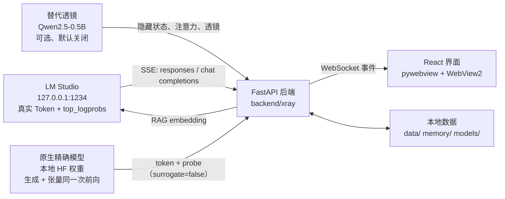

# 架构说明

本文说明 v1.1.0 的运行时、观测通道、数据流、性能预算与隐私边界。`docs/SPEC.md` 是 v1.0.0 的
实现契约；v1.1.0 新增原生精确通道与 no-logprobs 检测，增量以本页、API 与 CHANGELOG 为准。

## 1. 一句话架构

LM Studio 或进程内原生 Transformers 提供生成；一个可选的独立小模型在 LM Studio 模式下提供内部
状态的替身观测；同一个 FastAPI 后端把事件流汇入同一个 React 界面，所有数据都标注来源与精确性。

## 2. 运行时与观测通道

```text
+----------------------+     HTTP / SSE      +---------------------------+
|  LM Studio 0.4.x     | <-----------------> |  FastAPI backend          |
|  127.0.0.1:1234      |  responses (first)  |  backend/xray/            |
|  real tokens/probs   |  chat/completions   |  - LM Studio adapter      |
+----------------------+  embeddings (RAG)   |  - sessions / replay      |
                                             |  - RAG / metrics          |
+----------------------+   in-process       |  - native_bridge (exact)  |
|  native exact model  | ----------------->  +-------------+-------------+
|  local HF weights    |  token + probe                    |
|  CPU, float32        |  (surrogate=false)                | WebSocket /ws
+----------------------+                                   | JSON frames
                                                           v
+----------------------+   optional local PyTorch  +---------------------------+
|  surrogate lens      | ------------------------> |  React UI                 |
|  Qwen2.5-0.5B, CPU   |  hidden / attention /     |  pywebview + WebView2     |
|  default unloaded    |  tuned lens / residual    |  Canvas / SVG / Three.js  |
+----------------------+  features / UMAP          +---------------------------+
```

mermaid 版本（支持 Mermaid 的阅读器可渲染）：



关键点：

- 三种引擎互斥选择：`lmstudio`、`native`、`demo`。同一时刻只使用一种生成来源。
- `lmstudio` 模式下，替代透镜可选且不阻塞生成；`native` 模式下不运行替代透镜 worker，probe 与
  生成来自同一次前向，`probe.surrogate=false`、`same_weights=true`。
- 每个事件与面板都标注来源与精确性：LM Studio + 替代透镜显示“替代透镜”，原生精确模式显示
  “精确张量”。精确张量指“同一模型的精确内部状态”，不等于因果解释。
- demo 模式用本地合成器替代所有真实来源，只用于界面开发与演示，界面明确标注。
- 原生精确模式同一时间只允许一个生成会话，避免进程内两个前向同时占满 CPU/内存；冲突返回
  `BUSY`。

## 3. LM Studio 适配优先级

后端按以下顺序尝试，只在明确“接口或参数不支持”时降级：

1. `POST /v1/responses`，SSE，`stream=true`，`include=["message.output_text.logprobs"]`，
   `top_logprobs=12`，`store=false`。解析 `response.output_text.delta`、reasoning 事件与
   `response.completed`。这是唯一能同时拿到文本与 `top_logprobs` 的官方路径。
2. `POST /v1/chat/completions`，`stream=true`，`logprobs=true`，`top_logprobs=12`，并额外传
   `top_k` 与 `repeat_penalty`。解析 `choices[].delta`。
3. `POST /api/v1/chat`（原生 SSE），无 logprobs，只用于文本/推理流与统计。

降级规则：

- 仅在 HTTP 400/404/405 或明确的 "unsupported parameter" 时降级。
- 连接超时不降级，直接报 `LMSTUDIO_UNREACHABLE`，避免在用户模型加载期间反复无效请求。
- 启动应用、读取模型列表绝不触发模型加载；只有用户点击发送才发起生成。
- 思考内容（reasoning）作为独立事件，`kind="reasoning"`，对话窗默认折叠。
- 即使接口成功，流里也可能没有 `top_logprobs`。前 5 个回答 Token 都没有 top-k 时，后端发送
  `status(scope=runtime, state=no_logprobs)`，并把会话 `capabilities.logprobs` 标为 `false`；
  不会自动重发请求或切换引擎，由用户决定是否改用原生精确模式。


## 4. WebSocket 事件流

传输：`WS /ws`，JSON 文本帧。一次典型生成的事件顺序：

```text
client  {"type":"start","payload":{...}}          # 用户发送
server  {"type":"started","session":{...}}        # 会话元信息与能力
server  {"type":"rag","items":[...]}              # 可选：召回结果
server  {"type":"token","step":{...}}             # 每 Token，立即发送
server  {"type":"probe","step":N,"probe":{...}}   # 节流：默认每 2 个 Token
server  {"type":"projection","projection":{...}}  # 节流：默认每 8 个 Token
server  {"type":"metrics","metrics":{...}}        # 约 1.5 秒一次
server  {"type":"kv","kv":{...}}                  # KV 估算更新
server  {"type":"done","usage":{...}}             # 结束
```

其他事件：`hello`（连接即发，含 `native` 状态）、`status`（透镜/原生加载、`no_logprobs` 等）、
`error`、`pong`。

原生精确模式的事件顺序与上类似，但 probe 与 token 来自同一次前向，且会额外收到
`status(scope=native)`：

```text
client  {"type":"start","payload":{"mode":"native", ...}}
server  {"type":"started","session":{"capabilities":{...,"exact":true,"runtime":"native"}}}
server  {"type":"status","scope":"native","state":"loading"}    # 首次加载本地权重
server  {"type":"status","scope":"native","state":"prefill"}    # 编码提示词、建立 KV cache
server  {"type":"status","scope":"native","state":"generating"}
server  {"type":"token","step":{...}}
server  {"type":"probe","step":N,"probe":{"surrogate":false,"same_weights":true}}
server  {"type":"done", ..., "exact":true, "capabilities":{"exact":true,"logprobs":true}}
```

`done` 事件在 v1.1.0 增加可选字段 `capabilities`、`exact`、`surrogate`：原生会话为
`exact=true`，LM Studio 无 top-k 的会话为 `capabilities.logprobs=false`。旧客户端忽略这些字段
即可，不影响 v1.0 行为。

字段与示例见 [API.md](API.md)。事件只做向后兼容的新增：v1 内不删除字段、不改语义，新增字段
必须可缺省。

## 5. 前端渲染策略

- 高频面板（概率云、注意力热图、拓扑、KV 图、声化）使用 Canvas 或 CSS transform 自绘，
  不引入图表库，避免每个 Token 触发整页 React 重渲染。
- 逐 Token 更新只触及对应的观测组件；对话文本增量追加，不重建消息列表。
- `probe` 与 `projection` 事件是节流后的快照，前端按快照替换而不是累积高频状态。
- 尊重 `prefers-reduced-motion`：动画与 CRT 效果降级，不阻塞数据更新。
- 3D 向量云使用 Three.js，只在点集变化时重建缓冲区，渲染循环与生成循环解耦。
- JSONL 导出：桌面版通过 pywebview `js_api` 打开系统保存对话框写文件；浏览器环境回退 Blob
  下载；两种路径共用同一个前端导出结果提示（成功/取消/失败）。

## 6. 后端模块职责

| 模块 | 职责 |
| --- | --- |
| `backend/xray/` | FastAPI 应用、WebSocket 协议、LM Studio 适配、会话、采样辅助、RAG、回放、指标、静态前端托管 |
| `backend/xray/native_bridge.py` | 原生精确通道：进程内 Transformers 生成、状态机、依赖探测、`asyncio.to_thread` 桥接；`local_files_only` |
| `backend/xray/lens/` | 透镜/原生共用的引擎：模型加载、Tuned Lens 校准与缓存、注意力捕获、残差贡献、稀疏特征探针、UMAP/PCA 投影、demo 合成器 |
| `desktop/launcher.py` | pywebview 窗口与后端生命周期管理；以 `uvicorn xray.app:app` 启动后端；通过 `js_api.save_text_file` 提供原生保存对话框 |
| `apps/desktop/` | React 界面与构建产物；应用内“技术文档”页读取 `docs/*.md` |

实现约定：

- 核心不直接依赖 PyTorch。透镜/原生依赖是可选导入；任何导入失败都只让对应通道不可用，
  不影响 LM Studio 通道启动。
- 透镜队列落后时丢弃旧探测，保留最新一步，避免内存增长与延迟堆积。
- 原生通道复用 `LensEngine` 的 `prefill` / `sample_next`：一次前向同时给出 Token、top-k、
  隐藏状态、注意力与 probe；`set_native_mode(True)` 后 `surrogate=false`。
- 原生通道同一时间只允许一个生成会话（后端全局标记），避免两个进程内前向同时占用资源。
- 生成期间后端不做同步磁盘写；会话先留内存，完成后落盘。

## 7. 线程与性能预算

| 项 | 预算/策略 |
| --- | --- |
| 指标采样 | 约 1.5 秒一次；GPU 通过 `nvidia-smi` 子进程带超时，失败返回 null |
| probe 频率 | 默认每 2 个 Token；可配置放宽 |
| projection 频率 | 默认每 8 个 Token 重新拟合 |
| 透镜推理 | CPU 2 线程，进程优先级低于正常；懒加载、默认不启动 |
| 原生精确推理 | CPU 2 线程、float32、`local_files_only`；同一时间一个会话；0.5B 首次加载约 20-30 秒 |
| 队列策略 | 透镜模式落后时丢弃旧探测，只保留最新 |
| WebSocket | Token 立即发送，其他事件合并/节流；不堆积无界队列 |
| UI 更新 | Canvas/CSS transform；高频面板不走整页 React 重渲染 |
| UMAP | 最多 256 点；后台线程拟合；不足 8 点用 PCA，再不足用确定性伪投影 |

性能目标是“观测不改变被观测对象”：LM Studio 模式开启透镜允许一定开销，但不得阻塞 Token 流；
原生精确模式是另一条 CPU 推理路径，慢是预期行为，用户可随时切回 LM Studio。

## 8. 数据存储

| 路径 | 内容 | 生命周期 |
| --- | --- | --- |
| `data/sessions/<id>.jsonl` | 会话逐步快照（含 probe） | 生成完成后落盘，可删除 |
| `data/sessions/<id>.meta.json` | 会话元信息与消息 | 与 JSONL 配套，可删除 |
| `data/cache/` | Tuned Lens 校准缓存 `tuned_lens_<model>.pt` | 可删除，删除后重新校准 |
| `data/server.log` | 启动器启动的后端日志 | 排错用，可删除 |
| `data/*.jsonl` | 用户导出的回放数据 | 用户管理 |
| `memory/*.md` | RAG 记忆库源文件 | 用户维护，随项目版本管理 |
| `models/lens/` | 下载脚本获取的本地模型（替代透镜/原生精确共用） | 用户管理，git 忽略 |
| `data/cache/` | Tuned Lens 校准缓存 `tuned_lens_<model>.pt`、运行期缓存 | 可删除，删除后重新校准 |

导出的 JSONL 一行一个步骤，包含 Token 与 probe 快照，字段见 [API.md](API.md)。原生精确会话同样
落入 `data/sessions/`，`session.mode` 为 `native`。

## 9. 隐私与本地性

- 后端默认只监听 `127.0.0.1`，桌面版不对外网开放端口。
- 应用不包含任何云 API 客户端；对话、会话、遥测、指标都不上传。
- RAG 的 embedding 调用的是本机 LM Studio 的 `/v1/embeddings`，不经过第三方服务。
- 模型文件、透镜模型、原生模型、校准缓存、会话与导出文件都在本机磁盘。
- 原生精确通道以 `local_files_only` 加载本地 HF 权重，不联网、不自动下载；同一时间只运行一个
  生成会话。
- 唯一的外部网络行为由用户显式触发：`scripts/fetch_lens_model.ps1` 从 Hugging Face、镜像或
  ModelScope 下载模型（或用户自行用其他方式获取模型）。除此之外，应用不需要联网。
- LM Studio 是独立软件，其自身的网络行为（例如模型下载、统计）由 LM Studio 的设置决定，
  不属于本应用的控制范围。

## 10. 可扩展点

- `same-weights` 路径：把透镜模型指向与 LM Studio 相同的 HF 权重，可得到同一模型的精确隐藏状态。
  需要额外内存/显存，界面会标注。
- 原生精确通道：v1.1.0 的第二条“精确张量”路径，直接在进程内运行本地 HF 模型。后续可扩展更多
  本地运行时/设备（目前固定 CPU float32，不支持 4bit）。
- SAE 适配器：默认的稀疏特征是 `feature-probe`（MLP 神经元 + 词表方向解码），不是 SAE。
  若用户安装并配置 `sae_lens` 与匹配 checkpoint，可通过透镜引擎的适配器接口替换，界面标注
  `sae`；没有匹配 checkpoint 时不得把 probe 标成 SAE。
- 投影器：UMAP 可替换为 PCA 或确定性伪投影，事件中的 `reducer` 字段会标明当前方法。
